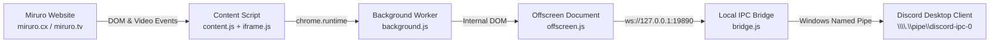

<div align="center">

  

  # Miruro Discord Rich Presence

  **A modern, standalone Manifest V3 Chrome Extension & lightweight Discord RPC bridge for Miruro.**  
  *Live anime covers, dynamic titles, real-time video sync, and customizable Discord profiles.*

  [](LICENSE)
  [](https://developer.chrome.com/docs/extensions/mv3/intro/)
  [](https://discord.com)
  []()

</div>

---

## ✨ Features

- 🎨 **Dynamic High-Resolution Cover Art**: Scrapes anime poster images directly from the DOM and falls back to AniList's GraphQL API for high-res cover art.
- 🏷️ **Dynamic Header Titles**: Shows `Watching [Anime Title]` in your Discord activity header rather than generic site titles.
- ⚡ **Instant Real-Time Video Sync**: Attaches direct event listeners to `<video>` players (including embedded cross-origin iframes) for 0ms latency on play, pause, and seek.
- ⏯️ **Play & Pause Sub-Icons**: Displays live animated state icons with accurate remaining time calculation.
- 🔗 **Interactive Action Buttons**:
  - `Watch Episode` / `View on Miruro` buttons that take your friends straight to what you're watching.
  - Optional `Discord Profile` button linking to your profile.
- 🛡️ **Zero External Servers & 100% Privacy**: Communicates entirely over local IPC (`\\.\pipe\discord-ipc-0`) on your machine. No telemetry, no external accounts, no cloud dependencies.
- ⚙️ **Custom User & App ID Support**: Customizable Discord User ID and Discord Developer Application ID directly in the popup UI.
- 🚀 **1-Click Silent Background Auto-Start**: Includes a 1-click Windows installer that runs the companion bridge silently in the background on PC boot with zero console windows.

---

## 📸 Preview

```
┌────────────────────────────────────────────────────────┐
│  Watching Miruro                                       │
│  ┌──────┐                                              │
│  │ COVER│  Frieren: Beyond Journey's End               │
│  │  ART │  Episode 28 - The End of the Journey         │
│  │      │  ▶ 14:32 remaining                           │
│  └──────┘  [ Watch Episode ]  [ Discord Profile ]      │
└────────────────────────────────────────────────────────┘
```

---

## 🚀 Quick Start Guide

### Step 1: Install the Chrome Extension

1. Clone or download this repository:
   ```bash
   git clone https://github.com/DulinNethmira/miruro-discord-rpc.git
   ```
2. Open Google Chrome (or any Chromium browser: Brave, Edge, Opera).
3. Navigate to `chrome://extensions/` in your address bar.
4. Enable **Developer mode** using the toggle switch in the top-right corner.
5. Click **Load unpacked** and select the [`miruro-rpc-extension`](miruro-rpc-extension) folder.

---

### Step 2: Start the Local Discord Bridge

Because Chrome restricts browser extensions from directly opening Windows Named Pipes (`\\.\pipe\discord-ipc-0`), a tiny 35-line Node.js loopback bridge relays the activity from Chrome into Discord desktop.

**Option A (Recommended — Silent Auto-Start)**:
- Double-click **`setup-bridge.bat`**.
- It installs a silent auto-start runner in your Windows Startup folder.
- The bridge will launch **in the background with NO open CMD window** and start automatically when your PC boots.

**Option B (Debug Console Mode)**:
- Double-click **`start-bridge.bat`** to run in an open terminal where you can inspect live presence events.

**To stop or uninstall the bridge**:
- Double-click **`stop-bridge.bat`**.

---

## ⚙️ Configuration & Customization

Click the **Miruro RPC** icon in your Chrome toolbar to open the control panel:

| Setting | Description | Default |
| :--- | :--- | :---: |
| **Enable Rich Presence** | Master switch to pause or resume presence | `ON` |
| **Show Browsing Status** | Displays when you are browsing Miruro | `ON` |
| **Show Video Timestamps** | Shows elapsed/remaining episode duration | `ON` |
| **Show Anime Cover Art** | Fetches and displays high-res anime posters | `ON` |
| **Show Action Buttons** | Adds clickable "Watch Episode" button | `ON` |
| **Your Discord User ID** | Adds a clickable "Discord Profile" button | *Optional* |
| **Discord Application ID** | Override with your own custom Discord Developer App | *Official App* |

---

## 🧩 Architecture



- **Manifest V3 Compliant**: Uses Chrome's `offscreen` API to maintain an active WebSocket connection without being killed by service worker sleep cycles.
- **Pure Node.js**: Zero external npm dependencies. Uses standard `net`, `http`, and `crypto` modules built into Node.js.

---

## 📦 Alternative: PreMiD Presence

If you prefer using [PreMiD](https://premid.app), a ready-to-use presence package is also included:
- **`miruro-premid.zip`**: Contains the updated `metadata.json`, `presence.js`, and `iframe.js` with full support for dynamic AniList covers, clean anime titles, and live video listeners.

---

## 🛠️ Requirements

- **Windows 10 / 11**
- **Discord Desktop App** (running locally)
- **Google Chrome** (or Chromium-based browser)
- **Node.js** (v16 or newer — download from [nodejs.org](https://nodejs.org) or run `winget install OpenJS.NodeJS`)

---

## 📄 License

Distributed under the **MIT License**. See [`LICENSE`](LICENSE) for details.

---

<div align="center">
  <sub>Built with ❤️ for anime lovers on Miruro.</sub>
</div>
