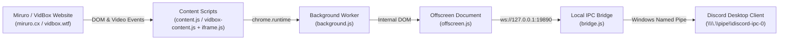

<div align="center">

  

  # Stream Discord Rich Presence
  ### Miruro (Anime) & VidBox (Movies & TV Series)

  **A modern, standalone Manifest V3 Chrome Extension & lightweight Discord RPC bridge for Miruro and VidBox.**  
  *Live posters, dynamic titles, season/episode detection, real-time video sync, and customizable Discord profiles.*

  [](LICENSE)
  [](https://developer.chrome.com/docs/extensions/mv3/intro/)
  [](https://discord.com)
  []()

</div>

---

## ✨ Features

### 🎬 Dual Platform Support
- **Miruro (Anime)**: `miruro.tv`, `miruro.cx`, `miruro.online`
- **VidBox (Movies & TV Series)**: `vidbox.wtf`, `vidbox.to`, `vidbox.cc`, `vidbox.ag`, `vidbox.me`
- **Tabbed Extension Popup**: Dedicated tab panels for **Miruro** and **VidBox** with independent toggles, preferences, and live activity previews.
- **Smart Arbitration**: Active video playback always takes priority; seamless switching when navigating or changing browser tabs.

### 🎨 High-Resolution Posters & Dynamic Metadata
- **Miruro**: High-res anime covers directly from DOM with automatic AniList GraphQL API resolution.
- **VidBox**: High-res TMDB posters, release years, TV show season/episode numbers and titles (`S{X} E{Y} - {Title}`).
- **Dynamic Header Titles**: Shows `Watching [Anime Title]` or `Watching [Movie/Show Title]` directly in your Discord activity header.

### ⚡ Instant Video Sync & Status Sub-Icons
- Attaches direct event listeners to `<video>` players (including embedded cross-origin player iframes like VidLink, VidRift, 2Embed, etc.).
- Animated **Play** and **Pause** sub-icons with live remaining time calculation.

### 🔗 Interactive Action Buttons
- `Watch on VidBox` / `Watch Episode` / `View on Miruro` buttons that take your friends straight to what you're watching.
- Optional `Discord Profile` button linking to your profile.

### 🛡️ Zero External Servers & 100% Privacy
- Communicates entirely over local IPC (`\\.\pipe\discord-ipc-0`) on your machine.
- No telemetry, no external accounts, no cloud dependencies.

### 🚀 1-Click Silent Background Auto-Start
- Includes a 1-click Windows installer (`setup-bridge.bat`) that runs the companion bridge silently in the background on PC boot with zero console windows.

---

## 📸 Preview

```
┌────────────────────────────────────────────────────────┐
│  Watching Lupin                                        │
│  ┌──────┐                                              │
│  │ TMDB │  Lupin                                       │
│  │ POSTER  S1 E1 - Chapter 1                           │
│  │      │  ▶ 38:12 remaining                           │
│  └──────┘  [ Watch on VidBox ]  [ Discord Profile ]    │
└────────────────────────────────────────────────────────┘
```

---

## 🚀 Quick Start Guide

### Step 1: Install the Chrome Extension

1. Clone or download this repository:
   ```bash
   git clone https://github.com/DulinNethmira/miruro-discord-rpc.git
   ```
2. Open Google Chrome (or any Chromium browser: Brave, Edge, Opera).
3. Navigate to `chrome://extensions/` in your address bar.
4. Enable **Developer mode** using the toggle switch in the top-right corner.
5. Click **Load unpacked** and select the [`miruro-rpc-extension`](miruro-rpc-extension) folder.

---

### Step 2: Start the Local Discord Bridge

Because Chrome restricts browser extensions from directly opening Windows Named Pipes (`\\.\pipe\discord-ipc-0`), a tiny zero-dependency Node.js loopback bridge relays the activity from Chrome into Discord desktop.

**Option A (Recommended — Silent Auto-Start)**:
- Double-click **`setup-bridge.bat`**.
- It installs a silent auto-start runner in your Windows Startup folder.
- The bridge will launch **in the background with NO open CMD window** and start automatically when your PC boots.

**Option B (Debug Console Mode)**:
- Double-click **`start-bridge.bat`** to run in an open terminal where you can inspect live presence events.

**To stop or uninstall the bridge**:
- Double-click **`stop-bridge.bat`**.

---

## ⚙️ Configuration & Customization

Click the extension icon in your Chrome toolbar to open the control panel:

- **Miruro Tab**:
  - Enable Miruro Presence
  - Show Browsing Status
  - Show Video Timestamps
  - Show Anime Cover Art
  - Show Watch Episode Button
- **VidBox Tab**:
  - Enable VidBox Presence
  - Show Browsing Status
  - Show Video Timestamps
  - Show Movie/TV Poster
  - Show Watch on VidBox Button
- **Discord Settings (Shared)**:
  - **Your Discord User ID**: Adds a clickable "Discord Profile" button to your activity card.
  - **Discord Application ID**: Override with your own custom Discord Developer Application ID.

---

## 🧩 Architecture



---

## 🛠️ Requirements

- **Windows 10 / 11**
- **Discord Desktop App** (running locally)
- **Google Chrome** (or Chromium-based browser)
- **Node.js** (v16 or newer — download from [nodejs.org](https://nodejs.org) or run `winget install OpenJS.NodeJS`)

---

## 📄 License

Distributed under the **MIT License**. See [`LICENSE`](LICENSE) for details.

---

<div align="center">
  <sub>Built with ❤️ for anime and movie lovers.</sub>
</div>
